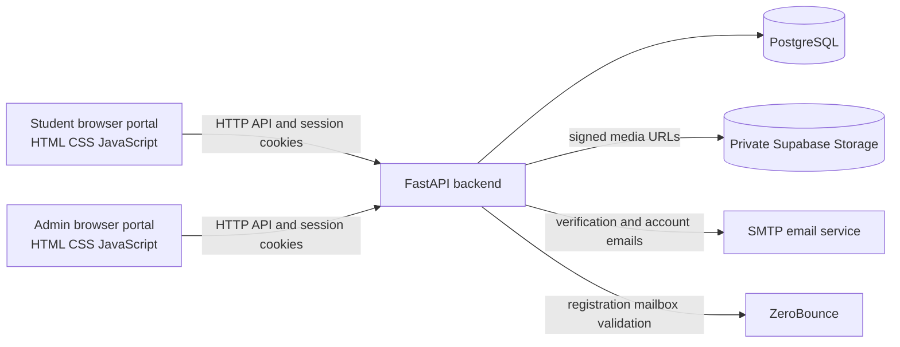

# EPS-TOPIK Quiz Platform

A web-based EPS-TOPIK exam practice platform with student and administrator portals. Students can work through published exams and question sets, while administrators manage exam content, student access, and results.

> **Implementation note:** Purchase-related pages support requesting access and coordinating payment through WhatsApp and administrator review. The repository does not implement an integrated payment processor.

## Contents

- [Features](#features)
- [Technology](#technology)
- [Architecture](#architecture)
- [Repository layout](#repository-layout)
- [Local development on Windows](#local-development-on-windows)
- [API documentation and health checks](#api-documentation-and-health-checks)
- [Database and migrations](#database-and-migrations)
- [Tests](#tests)
- [Deployment and external services](#deployment-and-external-services)
- [Security](#security)

## Features

### Student portal

The static student portal in `frontend/student/` includes:

- Account registration with email verification, login, logout, and password recovery flows.
- Profile editing and profile photo upload.
- Browsing published exams and sets, including requesting access to sets.
- Timed exam attempts, answer saving, submission, and result/review pages.
- Reading, image, and audio question content, with backend-enforced audio play limits.
- Contact/inquiry and access-request flows.

### Admin portal

The static admin portal in `frontend/admin/` includes:

- Admin sign-in and account/password security flows.
- Student and account management.
- Exam, set, question, option, and media management.
- Student results and attempt review.
- Student set-access request review and access controls.
- Audio play log and student inquiry management.

These describe functionality present in the checked-in pages and API routes; they are not a guarantee that required external services or production data are configured.

## Technology

- **Frontend:** Static HTML, CSS, and JavaScript; no frontend package manager or build step is defined in this repository.
- **Backend:** Python, FastAPI, SQLAlchemy, Pydantic, and Uvicorn.
- **Database:** PostgreSQL through Psycopg and SQLAlchemy.
- **Media:** Supabase Storage integration for exam and profile media.
- **Hosting configuration:** Vercel configuration is present for the frontend and backend.
- **Tests:** Pytest, including tests that use isolated temporary SQLite databases.

## Architecture



## Repository layout

```text
.
├── backend/
│   ├── app/                 FastAPI application, routes, models, services
│   ├── migrations/          Hand-maintained SQL migration files
│   ├── scripts/             Operational scripts, including media migration
│   ├── tests/               Backend regression and auth tests
│   ├── DEPLOYMENT.md        Deployment, storage, and database guidance
│   ├── .env.example         Backend configuration template
│   ├── requirements.txt     Backend Python dependencies
│   ├── index.py             Vercel/ASGI entry point
│   └── vercel.json          Backend Vercel configuration
├── frontend/
│   ├── student/             Student portal pages and scripts
│   ├── admin/               Admin portal pages and scripts
│   ├── api-config.js        Local and deployed API base URL behavior
│   └── vercel.json          Frontend rewrites and response headers
├── alembic/                 Alembic environment and revision files
├── tests/                   Root pytest tests
├── pytest.ini               Pytest discovery and import configuration
└── requirements.txt         Root-level Python requirements
```

The `_archive/` directory contains historical snapshots and is not the current application entry point.

## Local development on Windows

### Prerequisites

- Windows with Python installed and available as `py` or `python`.
- A PostgreSQL database configured for development. The application settings require `DATABASE_URL`; this README does not create a database or apply a schema.
- SMTP settings are required by the admin settings module. Email-dependent flows also require a usable SMTP service.
- Supabase and ZeroBounce configuration is needed for the corresponding media and registration flows; see [Deployment and external services](#deployment-and-external-services).

### Create the environment and install dependencies

Run these commands from the repository root in PowerShell:

```powershell
py -m venv .venv
.\.venv\Scripts\Activate.ps1
python -m pip install --upgrade pip
python -m pip install -r backend\requirements.txt
python -m pip install -r requirements.txt
```

The root requirements include pytest; the backend requirements provide the application dependencies.

If PowerShell blocks virtual environment activation due to its execution policy, activate the environment using the policy approved for your machine or invoke its Python directly as `.\.venv\Scripts\python.exe`.

### Configure environment variables

Create a local backend environment file from the template:

```powershell
Copy-Item backend\.env.example backend\.env
```

Edit `backend/.env` and provide at least the required values for `DATABASE_URL`, `SECRET_KEY`, `SMTP_USERNAME`, `SMTP_PASSWORD`, and `SMTP_FROM_EMAIL`. `SECRET_KEY` must be unique and at least 32 bytes. The example file documents optional settings including SMTP host/port, CORS origins, database pool limits, Supabase Storage, ZeroBounce, OTP limits, and token lifetimes. Replace placeholders as applicable; do not commit the populated `.env` file.

The app's settings read `.env` from the backend directory or repository root. Do not use a production/shared database for local development or test runs.

### Start the backend

In a PowerShell window from the repository root:

```powershell
Set-Location backend
..\.venv\Scripts\python.exe -m uvicorn index:app --reload --host 127.0.0.1 --port 8000
```

The API entry point is `backend/index.py`. Database-backed endpoints need a reachable, correctly prepared PostgreSQL database. No migration is run by this command.

### Start the frontend

In a second PowerShell window from the repository root:

```powershell
Set-Location frontend
py -m http.server 5500 --bind 127.0.0.1
```

Open `http://127.0.0.1:5500/` for the student entry page. Admin pages are under `/admin/`, beginning with `/admin/ad-login.html`. On localhost, `frontend/api-config.js` selects the API at `http://127.0.0.1:8000` (or the hostname-specific localhost equivalent).

These are source/configuration-based commands; a complete local launch was not performed as part of documenting this repository.

## API documentation and health checks

With the backend running:

- Swagger UI: [`http://127.0.0.1:8000/docs`](http://127.0.0.1:8000/docs)
- OpenAPI schema: `http://127.0.0.1:8000/openapi.json`
- Liveness-style health response: `GET /health`
- Database readiness check: `GET /ready`

`/health` returns a healthy status without checking PostgreSQL. `/ready` executes `SELECT 1` and returns HTTP 503 when the database is unavailable. The root route `/` also returns a simple service status.

## Database and migrations

PostgreSQL is the system of record for user accounts, exams and sets, questions and options, exam sessions, student answers, results, and audio play logs. Exam attempts and results are persisted by the backend; application-level authorization is enforced in FastAPI.

There are two migration-related locations: Alembic revisions under `alembic/versions/` and manual SQL files under `backend/migrations/`. The deployment guide describes important SQL migration prerequisites and ordering, including backup and duplicate checks for set-scoped attempt/question changes. Some SQL index statements must be run outside a transaction. Other changes have their own prerequisites, such as applying access-request schema before using related controls.

**Do not assume every migration can be applied together or safely rerun.** Review the exact migration and [backend deployment guide](backend/DEPLOYMENT.md) against the target schema and deployment state. Back up the database, resolve documented prechecks, and follow the file-specific procedure. This README intentionally does not prescribe a blanket Alembic upgrade or SQL batch command. No database connection or migration was run to prepare this README.

`backend/DEPLOYMENT.md` also documents the optional one-time embedded-media migration script. It has a dry-run mode and a separate apply option; review that guide and the script before using it.

## Tests

The repository uses pytest. From the repository root, the configured default discovery command is:

```powershell
python -m pytest
```

`pytest.ini` sets `testpaths` to `tests` and `backend/tests`, adds `backend` to the import path, and narrows default collection to filenames matching `test_exam.py`, `test_question.py`, `test_quiz.py`, `test_scoring.py`, `test_timer.py`, and `test_current_*.py`. Some older API test files are present but intentionally excluded by that filename filter because they target a removed API. `tests/test_current_api_regression.py` and `backend/tests/test_current_set_isolation.py` use temporary SQLite databases in their fixtures.

The student registration test does not match the configured default filename patterns. To request it explicitly, use:

```powershell
python -m pytest backend/tests/test_student_registration_auth.py
```

The commands above describe pytest configuration and test files; the tests were not run during repository inspection or README preparation. A working Python environment and installed dependencies are prerequisites. Check test fixtures before running tests because importing the application still loads required settings; do not point test configuration at a shared or production database.

## Deployment and external services

Deployment configuration and operational steps are documented in [`backend/DEPLOYMENT.md`](backend/DEPLOYMENT.md). The repository contains Vercel configs at `backend/vercel.json` and `frontend/vercel.json`. The deployment guide describes setting the backend project's root directory to `backend`, configuring server-side environment variables, deploying the frontend rewrite with the backend, and using a pooled PostgreSQL URL within the database provider's connection limits.

The frontend config currently rewrites `/backend/*` to **`https://test-pink-six-77.vercel.app`**, a test deployment. This is a checked-in configuration value, not a production endpoint guarantee. Review and replace it with the intended backend deployment before publishing a frontend deployment.

External services used by the code/configuration:

| Service | Supported role in this repository |
| --- | --- |
| PostgreSQL | Persistent application data accessed by SQLAlchemy/Psycopg. |
| Supabase Storage | Private exam/profile media storage; backend code creates signed upload and access URLs. The deployment guide requires a private `exam-media` bucket and a server-only service-role key. |
| SMTP | Sends student verification/password-reset email and admin/support messages. Admin settings require SMTP credentials. |
| ZeroBounce | Validates student registration email addresses before the OTP step. Registration fails closed when validation is not configured or unavailable, according to the deployment guide. |

The purchase flow visible in the frontend arranges payment via WhatsApp and administrator review. Do not interpret it as card processing or a payment gateway integration.

## Security

- Keep `backend/.env`, database URLs, `SECRET_KEY`, SMTP passwords, Supabase service-role keys, and ZeroBounce keys out of source control and frontend code.
- Use a unique `SECRET_KEY` of at least 32 bytes. Keep server-side secrets server-side; do not put service-role credentials in browser-visible variables.
- The backend uses HttpOnly session cookies, and the frontend is configured to include credentials on API requests. Do not restore JWTs to browser storage.
- Use a private Supabase Storage bucket and the signed URL flow described in the deployment guide.
- Follow the deployment guide's database backup, migration, and connection-pool guidance before making schema or hosting changes.
